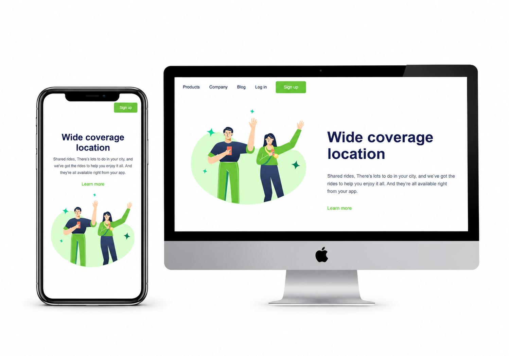

📱 Projeto: Apresentação Responsiva

Projeto desenvolvido durante meus estudos no DevClub, com o objetivo de aprender e praticar os fundamentos do desenvolvimento web.

Neste projeto, utilizei:

HTML5: para estruturar o conteúdo da página.

CSS3: para estilizar os elementos e construir o layout.

Responsividade: para adaptar a página a diferentes tamanhos de tela, como computadores e celulares.

🖥️ Visualização do projeto

Confira abaixo como ficou o resultado em diferentes dispositivos:

